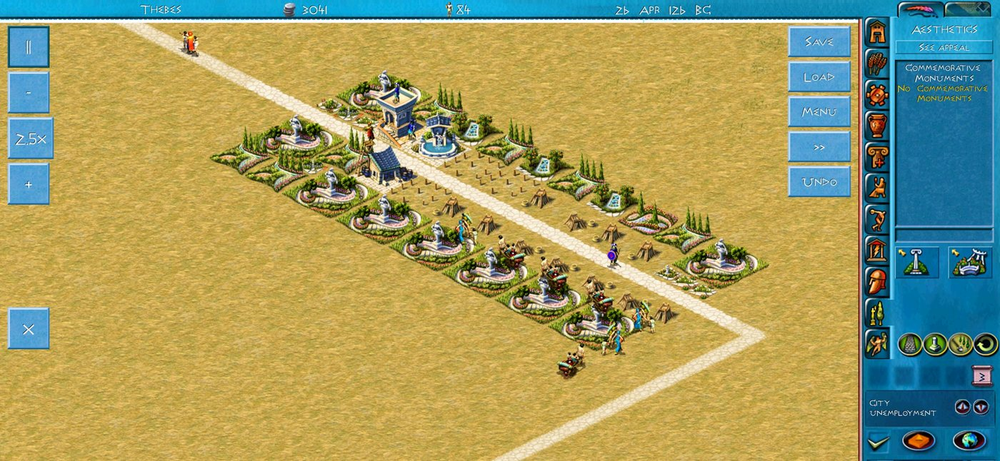
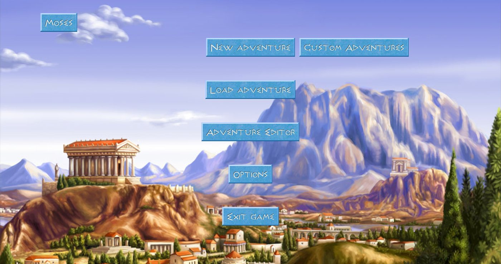
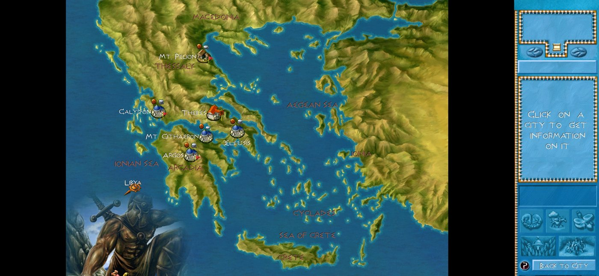
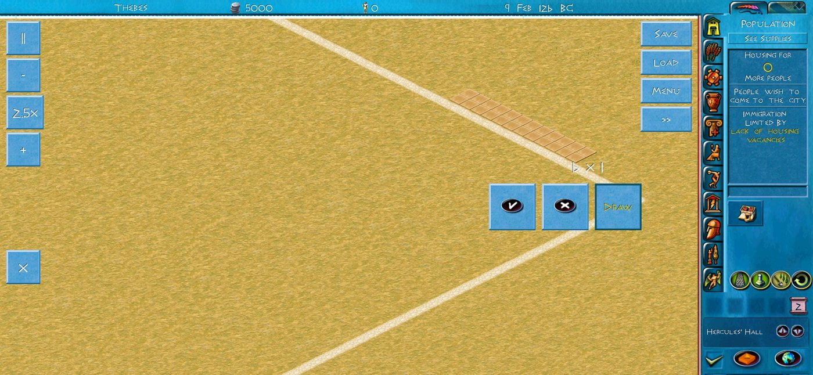

<div align="center">

# ZeusDroid

**Zeus: Master of Olympus + Poseidon, running natively on Android.**

A touch-first Android port of the classic city builder, built on the open-source
[eZeus](https://github.com/MaurycyLiebner/eZeus) engine. No emulation, no streaming:
real arm64 code, played with your own copy of the game.

[](https://github.com/mosestyle/ZeusDroid/releases/latest)
-3ddc84)

[](LICENSES/NOTICE.md)



</div>

## Screenshots

<table>
  <tr>
    <td width="50%"></td>
    <td width="50%"></td>
  </tr>
  <tr>
    <td align="center"><sub>Main menu with Zeus, Poseidon and custom adventures</sub></td>
    <td align="center"><sub>World map: trade, requests, gifts, raids and conquests</sub></td>
  </tr>
  <tr>
    <td colspan="2"></td>
  </tr>
  <tr>
    <td colspan="2" align="center"><sub>Building with touch: preview, then confirm with ✓, cancel with ✕ or draw a whole row</sub></td>
  </tr>
</table>

## Features

- **The full game** – every Zeus and Poseidon adventure, plus custom adventures and the
  open-play sandboxes, with the original rules, graphics, music and voices.
- **Native performance** – the eZeus C++ engine compiled for arm64, rendering at up to
  60 FPS.
- **Made for touch**
  - drag to scroll, pinch to zoom, on-screen zoom and speed buttons;
  - buildings are previewed first and placed with ✓, rows, areas and roads are drawn with
    one finger (smart straight roads);
  - **Undo** for the last placement;
  - long press for information and to cancel.
- **Quick Save / Load** buttons, autosave when the app goes to the background, and the
  camera position is restored when you load a game.
- **Full original interface** – side panel with alerts, the Messages list, episode goals,
  rotate city and world map; three interface sizes to fit your screen.
- **Your own game files only** – the importer copies your installation into the app; the
  graphics packs are built on the phone from your original files (about a minute, once).

## Getting started

You need your own copy of **Zeus: Master of Olympus** with the **Poseidon** expansion
(for example the GOG edition). No game files are included in this project.

1. Download `ZeusDroid-<version>.apk` from the
   [latest release](https://github.com/mosestyle/ZeusDroid/releases/latest) and install it.
2. Copy your **Zeus and Poseidon** install folder from your PC to the phone (USB, SD card
   or cloud storage).
3. Open ZeusDroid, tap **Import game folder…** and pick that folder.
4. Tap **Start game**. The first start prepares the graphics from your game files; after
   that the game starts straight away.

Your saves are kept when you import again or install a newer version.
More: [game data](docs/GAME_DATA.md) · [touch controls](docs/TOUCH_CONTROLS.md) ·
[release notes](docs/RELEASE_NOTES.md).

## Requirements

| | |
|---|---|
| Android | 8.0 (API 26) or newer, 64-bit ARM (arm64-v8a) |
| Storage | your game files plus about 0.5 GB for the prepared graphics |
| Game | your own Zeus: Master of Olympus + Poseidon installation |

## Building from source

```bash
# Desktop (Linux) reference build and tests
cmake -S engine -B build/desktop -G Ninja -DCMAKE_BUILD_TYPE=Release -DEZEUS_SYSTEM_SDL=ON
ninja -C build/desktop
tools/tests/run_unit_tests.sh

# Android APK (arm64-v8a)
tools/build_android.sh            # or: cd android && ./gradlew assembleDebug
```

Details: [Android build](docs/BUILD_ANDROID.md) · [Windows build](docs/BUILD_WINDOWS.md) ·
[texture builder](docs/TEXTURE_BUILDER.md).

<details>
<summary><b>Repository layout</b></summary>

| Path | Content |
|---|---|
| `engine/` | eZeus engine (GPL-3.0) with the port changes |
| `engine/platform/` | Android / desktop platform layer: paths, touch gestures, frame clock, test driver |
| `engine/texbuild/` | builds the graphics packs from the original game files |
| `android/` | manifest, SDL2 glue, first-run importer, Gradle files |
| `tools/` | APK build, asset tools, test runners, release script |
| `tests/` | native (C++), Java and Python tests, scripted desktop tests |
| `docs/` | build, controls, data, parity, performance and test reports |

Project status: [PROJECT_STATE.md](PROJECT_STATE.md) · next steps:
[NEXT_STEPS.md](NEXT_STEPS.md).
</details>

<details>
<summary><b>How releases are made</b></summary>

`tools/release/publish_apk.sh` puts the built APK on the `apk` branch; its GitHub Action
creates the release `v<version>` (tagged at the source commit on `main`) with the APK and
the notes for that version from `docs/RELEASE_NOTES.md`.
</details>

## Credits and licence

- **[eZeus](https://github.com/MaurycyLiebner/eZeus)** by Maurycy Liebner and contributors –
  the open-source engine this port is built on.
- **[SDL2](https://www.libsdl.org/)**, SDL_image, SDL_mixer and SDL_ttf.

ZeusDroid is free software under the **GPL-3.0** licence (inherited from eZeus); third-party
notices are in [LICENSES/NOTICE.md](LICENSES/NOTICE.md).

*Zeus: Master of Olympus* and *Poseidon* are trademarks and copyrighted works of their
respective owners. This is an unofficial fan project, not affiliated with or endorsed by
them or by the eZeus authors. The screenshots show the game running with the original
game files, which are not part of this project.
